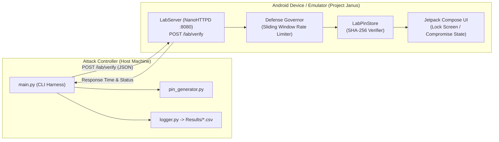

# Project Janus 🏛️
> **Dual-Faced Mobile Authentication Security & PIN Enumeration Research Testbed**

[](https://developer.android.com)
[](https://kotlinlang.org)
[](https://developer.android.com/jetpack/compose)
[](#overview)

---

## Overview

Named after **Janus**—the Roman god of doors and gates depicted with two faces looking in opposite directions—**Project Janus** is an instrumentation and benchmarking framework designed to evaluate both sides of mobile authentication security:
1. **The Attack Face (Offensive Automation)**: Automated PIN enumeration and brute-force stress testing across local network interfaces.
2. **The Defense Face (Countermeasure Benchmarking)**: Real-time telemetry, response-time profiling, and rate-limiting enforcement within an Android application.

Project Janus simulates a high-security mobile vault app with an embedded research verification daemon, paired with an external Python test harness for empirical measurement.

---

## Architecture



---

## Repository Structure

```
├── app/                                 # Android application source
│   ├── src/main/java/com/atharva/securevault/
│   │   ├── authentication/             # Authenticator implementations
│   │   │   ├── PinAuthenticator.kt     # Verification bridge & telemetry
│   │   │   └── ResearchAuthenticator.kt# Lab gatekeeper (Default PIN: 2468)
│   │   ├── network/
│   │   │   └── LabServer.kt            # Embedded NanoHTTPD daemon (Port 8080)
│   │   ├── security/
│   │   │   ├── crypto/
│   │   │   │   ├── CryptoService.kt    # PBKDF2 (100k rounds), SHA-256, Constant-Time comparison
│   │   │   │   └── HashAlgorithm.kt    # Algorithm enum (PBKDF2_HMAC_SHA256 vs LEGACY_SHA256)
│   │   │   ├── domain/
│   │   │   │   └── VerificationResult.kt # High-resolution execution & security telemetry
│   │   │   ├── keystore/
│   │   │   │   └── KeyStoreManager.kt  # Android Keystore hardware-backed AES-256-GCM
│   │   │   ├── storage/
│   │   │   │   └── SecurePinStore.kt   # Encrypted credential persistence at rest
│   │   │   ├── LabPinStore.kt          # Lab configuration bridge
│   │   │   └── PinVerifier.kt          # Dual-mode cryptographic verifier
│   │   ├── MainActivity.kt             # Jetpack Compose UI routing & Lab controls
│   │   ├── VaultHomeScreen.kt          # Simulated protected vault records
│   │   ├── CompromiseReportScreen.kt   # Real-time compromise alert screen
│   │   └── DefenseMode.kt              # Countermeasure modes (NONE, RATE_LIMIT)
│   └── src/test/java/                  # Comprehensive JUnit test suite
│       └── com/atharva/securevault/security/
│           └── CryptoServiceTest.kt    # Determinism, salt uniqueness, and timing unit tests
│
├── Python attack controller/
│   └── Attack-Controller/
│       ├── main.py                     # Attack runner & benchmarking CLI
│       ├── pin_generator.py            # Zero-padded 4-digit PIN candidate generator
│       ├── logger.py                   # CSV export & experiment logger
│       └── Results/                    # Historical benchmark datasets
│
└── README.md
```

---

## Features

* **Hardware-Backed Keystore (TEE / StrongBox)**: Master keys generated directly inside Android's hardware security module with AES-256-GCM, encrypting verification records and salts at rest.
* **Dual Key Derivation Architecture**:
  * **Hardened Mode**: PBKDF2 with HMAC-SHA256, cryptographically random 128-bit salt, 100,000 iterations, and constant-time byte comparisons (`MessageDigest.isEqual`).
  * **Vulnerable Baseline Mode**: Raw unsalted SHA-256 with intentional early-exit comparisons to benchmark rainbow table exposure and timing side-channels.
* **Embedded Verification Daemon**: NanoHTTPD server runs directly in the Android process on port `8080`, allowing isolated authentication calls without cloud dependencies.
* **Reactive Compromise Detection**: Jetpack Compose observes Kotlin Coroutine `StateFlow` streams. The moment the correct PIN is received via the API, the app transitions in real-time to a `CompromiseReportScreen` with telemetry metrics.
* **Rate-Limiting Defense Mode**: Evaluates sliding window request throttling (e.g., maximum 5 attempts per 10-second window, yielding HTTP 429 `TOO_MANY_REQUESTS`).
* **Nanosecond Telemetry Logging**: Measures internal cryptographic/verification latency (`responseTimeMs`, `executionTimeNanos`) separately from network latency and records timestamped CSV datasets in `Results/`.

---

## Quickstart

### 1. Build and Run the Android App

1. Open the project in **Android Studio**.
2. Connect an Android device (or launch an emulator) on the same local Wi-Fi network.
3. Build and install:
   ```bash
   ./gradlew installDebug
   ```
4. On the lock screen, tap **SECURITY LAB**.
5. Enter the researcher access PIN: `2468`.
6. Set your **Target PIN** (e.g. `0042`) and save. Note down your device's local IP address.

### 2. Run the Attack Controller

Ensure Python 3 is installed.

```bash
cd "Python attack controller/Attack-Controller"

# Run a test against target device
python main.py --ip <DEVICE_IP> --port 8080 --start 0 --end 100 --delay 0.05
```

#### CLI Parameters:
* `--ip`: IP address of the target Android device (Default: `192.168.1.45`)
* `--port`: Port running `LabServer` (Default: `8080`)
* `--start`: Starting numeric PIN candidate (Default: `0`)
* `--end`: Ending numeric PIN candidate (Default: `9`)
* `--delay`: Throttle interval between consecutive requests in seconds (Default: `0.0`)
* `--max-attempts`: Safety threshold to halt testing (Default: `100`)

---

## Research Disclaimer

This project is created strictly for **academic and security research purposes** to demonstrate the importance of multi-factor authentication, account lockouts, rate limiting, and secure hardware keystores (e.g., Android Keystore / StrongBox). Do not use this software against any target without explicit authorization.
